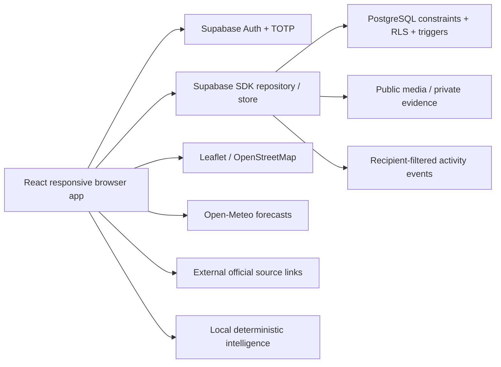

# Architecture

One static Vite application serves desktop and mobile browsers. React Router implements actual routes; the responsive shell uses Radix dialog primitives for focus trapping, Escape/outside dismissal and focus restoration. Local shadcn-style button/dialog components are owned by the project and use CVA/Radix. Tailwind v4 and shared CSS define the original tourism identity. Lucide supplies icons. Leaflet/React Leaflet use OSM attribution; Recharts renders administrator feedback counts. Route splitting keeps map and analytics code off the initial feed bundle.

## Ownership and modules

- `src/main.tsx`: routes, error boundary and scroll restoration.
- `components/Layout`: sidebar, accessible mobile drawer, search, account, notification bell.
- `components/ui`: reusable button/dialog composition; `common`: cards, avatars, ratings, badges, skeletons, empty states, timestamps.
- `features/Home`: actual-record municipality feed, incremental display, compose/preview, comments/replies, review interactions, own edit/delete and public share links; profile/search/post routes.
- `features/Map`: markers/popups, filters and sentiment/congestion layers; saved places, editable ranked itinerary with reasons/cost uncertainty and persistence. `Simulation` shares the exact capacity calculation with administration.
- `features/Hub`: enterprise/heritage submissions, external coordination, authorized profile edits, destination/business details and reviews.
- `features/Auth`: Supabase signup/login/reset/OAuth; profile/security/preferences settings; TOTP enrollment/challenge lifecycle.
- `features/Community`: private notifications, RINI source lookup, private feedback/evidence/status tracking and protected administrator review/analytics.
- `lib/store`: session/data loading, SDK writes, image processing/uploads, toasts and real-time recipient updates. Request versioning discards stale results after account changes; no private state is intentionally retained on logout.
- `lib/intelligence`: pure congestion, approximate sentiment/topic classification, source-grounded lookup, explainable feed/itinerary ranking. RINI passes recognized trip preferences to the real MAP route.

## Data flow

Public visitors read published listings/posts. Authenticated actions write through Supabase SDK with the user's JWT; server policies enforce ownership independently of the interface. Comments/reactions/status decisions generate server-constructed notifications. Post reports quarantine content pending review. Admin authorization reads a protected role table and requires AAL2. Display roles never grant permissions.

HOME saves listing IDs → private saved items → MAP stop selection and weighted suggestions → private saved itineraries. Published destination reviews → approximate sentiment counts/topic samples → MAP/detail/admin. Private feedback stays outside public reviews, feed and RINI. Privileged feedback transitions → audit and recipient notifications.

## Modes and limitations

Supabase is required for the application. Missing configuration is reported as an error instead of selecting a local or read-only preview, and backend failures are surfaced rather than silently switching to a fake working backend. Browser storage is used only for non-secret feed interests scoped to account ID; chat is tab memory. Optional PWA/IndexedDB/AR/payments are deferred.

Map tiles and weather fail independently; accessible place lists and official-source links remain available. No routing engine, live vessel feed, sensor, paid LLM, booking, checkout or native mobile code exists. Forecast requests have cancellation/timeouts, retry and last-retrieval information when data exists.

Initial data fetches are capped at 500 accessible posts/events with incremental feed display. For production scale, add server-side cursor pagination, aggregate RPCs and subscription status monitoring. Connected application behavior still requires live end-to-end validation, not just source inspection.
